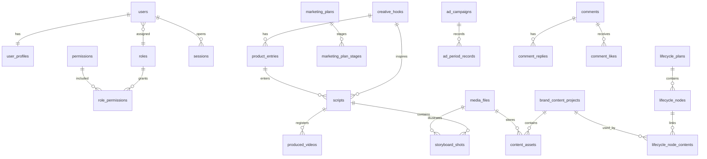

# 目标 ER 图

这是 README 第 15 节要求的目标模型，不是当前 SQLite 结构。当前库仍是 `state.entries` 加旁路表。多态评价和标签使用 `entity_type`、`entity_id`，图中不画假外键。

## 实体职责

| 实体 | 职责 |
| --- | --- |
| users / user_profiles / roles / permissions / role_permissions / sessions | 账号、资料、角色、权限和持久会话 |
| creative_hooks / product_entries / scripts | 钩子、出场、完整脚本，使用真实外键 |
| storyboard_shots / produced_videos | 脚本分镜和成品登记 |
| brand_content_projects / content_assets | 品牌内容项目和单张图片 |
| marketing_plans / marketing_plan_stages | 营销方案和可排序阶段 |
| lifecycle_plans / lifecycle_nodes / lifecycle_node_contents | 客户生命周期及关联内容 |
| ad_campaigns / ad_period_records | 投放批次和素材周期，不按天拆分存储 |
| competitor_insights | 六类竞品洞察 |
| tags / entity_tags | 通用标签 |
| comments / comment_replies / comment_likes | 通用评价、回复和点赞 |
| notifications / activity_logs / revisions / archives | 动态、审计、修订和软删除 |
| media_files | 原图、预览、缩略图和 SHA-256，不存 Base64 |

每张业务表保留创建时间、更新时间、版本和软删除所需字段。搜索和筛选字段建索引。结构只通过 Alembic 变更。
